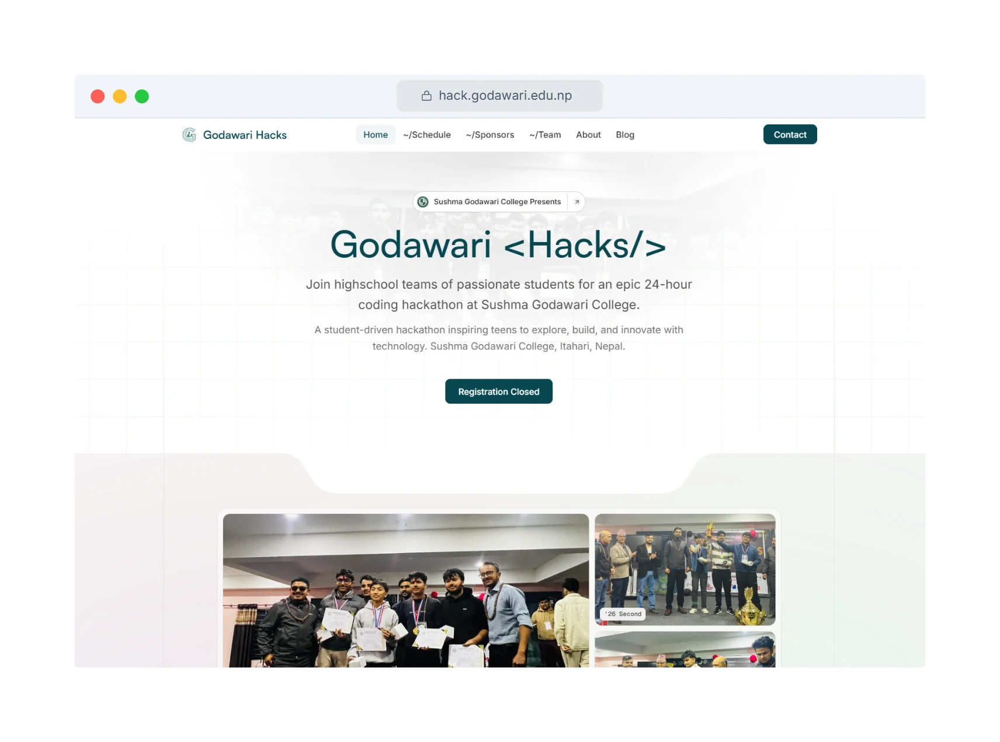
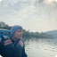

# Godawari Hacks

A 24-hour hackathon for high school students at Sushma Godawari College, Itahari, Nepal. Teams of teens come together to explore, build and ship something new with technology. Every team's project lives here as its own repo.

[hack.godawari.edu.np](https://hack.godawari.edu.np)

  

## Outside Collaborators

A big thank you to everyone collaborating with us from outside the org 💙

<!-- CONTRIBUTORS:START -->

<!-- Generated by .github/workflows/contributors.yml — do not edit by hand. -->
<table>
  <tbody>
    <tr>
      <td align="center" valign="top" width="16%">
        <a href="https://github.com/Abish-code" title="Abish karki — let us all improve together🚀">
           
          <b>Abish karki</b>
        </a> 
        @Abish-code
      </td>
      <td align="center" valign="top" width="16%">
        <a href="https://github.com/AnupKoirala0" title="ANUP KOIRALA — computer-science">
           
          <b>ANUP KOIRALA</b>
        </a> 
        @AnupKoirala0
      </td>
      <td align="center" valign="top" width="16%">
        <a href="https://github.com/David-Rai" title="David — Lets become engineer not a frameworker">
           
          <b>David</b>
        </a> 
        @David-Rai
      </td>
      <td align="center" valign="top" width="16%">
        <a href="https://github.com/devid99pros" title="Dayyvid">
           
          <b>Dayyvid</b>
        </a> 
        @devid99pros
      </td>
      <td align="center" valign="top" width="16%">
        <a href="https://github.com/GreeceDev" title="Greece Dahal — I do web and app things">
           
          <b>Greece Dahal</b>
        </a> 
        @GreeceDev
      </td>
      <td align="center" valign="top" width="16%">
        <a href="https://github.com/KafleAnurag" title="Mr. Kafle — Peace">
           
          <b>Mr. Kafle</b>
        </a> 
        @KafleAnurag
      </td>
    </tr>
    <tr>
      <td align="center" valign="top" width="16%">
        <a href="https://github.com/Manish-Tamang" title="Manish Tamang — i do web things">
           
          <b>Manish Tamang</b>
        </a> 
        @Manish-Tamang
      </td>
      <td align="center" valign="top" width="16%">
        <a href="https://github.com/moshabbirahamed-netizen" title="moshabbirahamed-netizen">
           
          <b>moshabbirahamed-netizen</b>
        </a> 
        @moshabbirahamed-netizen
      </td>
      <td align="center" valign="top" width="16%">
        <a href="https://github.com/NuxGajurel" title="Nux Gajurel — 16-year-old | I code cool web stuff 🌻">
           
          <b>Nux Gajurel</b>
        </a> 
        @NuxGajurel
      </td>
      <td align="center" valign="top" width="16%">
        <a href="https://github.com/patties-eater" title="Prajjwal Gautam — @prajjwalgautam">
           
          <b>Prajjwal Gautam</b>
        </a> 
        @patties-eater
      </td>
      <td align="center" valign="top" width="16%">
        <a href="https://github.com/Prabesh002" title="Nellow — Silly goofy teen messing around with code">
           
          <b>Nellow</b>
        </a> 
        @Prabesh002
      </td>
      <td align="center" valign="top" width="16%">
        <a href="https://github.com/shreay-git" title="shreay-git">
           
          <b>shreay-git</b>
        </a> 
        @shreay-git
      </td>
    </tr>
    <tr>
      <td align="center" valign="top" width="16%">
        <a href="https://github.com/SuprimOjha" title="Suprim Ojha">
           
          <b>Suprim Ojha</b>
        </a> 
        @SuprimOjha
      </td>
      <td align="center" valign="top" width="16%">
        <a href="https://github.com/ujwalkhatiwadaa" title="Ujwal Khatiwada">
           
          <b>Ujwal Khatiwada</b>
        </a> 
        @ujwalkhatiwadaa
      </td>
    </tr>
  </tbody>
</table>

<!-- CONTRIBUTORS:END -->

> Refreshed automatically every day by [`contributors.yml`](.github/workflows/contributors.yml).
